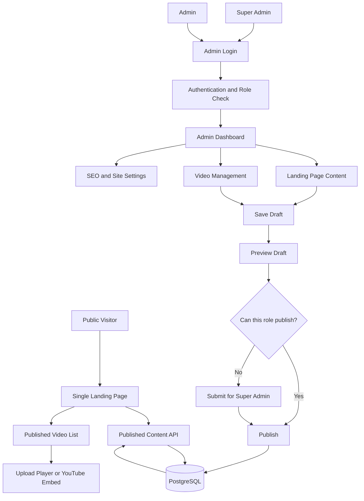

# Application Flow
## Doctor Portfolio & Health Education Website

**Version:** 1.0

## 1. High-level application flow

## 2. Public visitor flow

1. Visitor opens the public site.
2. The application selects Bangla by default.
3. Frontend requests published landing-page content.
4. API returns the currently published content version.
5. Visitor can switch language to English.
6. Frontend renders the same single-page layout with translated content.
7. Visitor can play a published server-uploaded video or YouTube video.
8. Visitor can use verified contact links.

No appointment-related action or route is available.

## 3. Admin authentication flow

1. Admin opens `/admin/login`.
2. Admin submits credentials.
3. Backend validates credentials and account status.
4. Backend issues the configured secure session/token.
5. Frontend loads role-appropriate dashboard navigation.
6. Every protected API request is authenticated and authorized by the backend.
7. Logout invalidates the session according to the selected authentication strategy.

The frontend must not be the only enforcement point for roles.

## 4. Landing-page content workflow

1. Admin opens Content Management.
2. Admin selects a section or content item.
3. Admin edits Bangla and English fields.
4. Admin saves as draft.
5. Admin opens Preview.
6. Preview loads draft content in an isolated preview context.
7. Public API continues serving the last published version.
8. If the current role has publish permission, user publishes.
9. Otherwise, the draft is submitted for Super Admin review.
10. On publication, the backend atomically updates the published version and records the actor/time.

## 5. Video workflow

### Server upload

1. Admin selects “Upload video”.
2. Admin selects a local video file.
3. Frontend checks basic file information for usability.
4. Backend enforces authentication, authorization, configured file-size limit, allowed format and file signature.
5. Backend inspects actual duration using a trusted media inspection process.
6. If duration exceeds 180 seconds, reject the upload.
7. If valid, store the video file in configured server storage.
8. Save metadata and storage key in PostgreSQL.
9. Admin adds bilingual title/description, thumbnail, category and display options.
10. Save draft → preview → publish.

### YouTube integration

1. Admin selects “Add YouTube video”.
2. Admin submits a YouTube URL.
3. Backend validates the URL and extracts the video ID.
4. Backend verifies duration through YouTube Data API when configured.
5. If duration exceeds 180 seconds, reject publication.
6. If duration cannot be verified, retain as unverified draft.
7. Admin supplies bilingual metadata and thumbnail choice.
8. Save draft → preview → publish.

## 6. Preview isolation

- Preview endpoint requires an authenticated, authorized user.
- Draft content is never returned by the public published-content endpoint.
- Preview must not be indexed by search engines.
- Preview links should be short-lived or protected by authenticated access.
- Preview should visually match the public landing page.

## 7. Error and recovery flows

- API unavailable: show an accessible retry/error state; do not silently replace published content with stale draft data.
- Upload interrupted: report failure and clean up incomplete temporary files.
- Invalid media: reject with a clear reason.
- Database failure during publish: retain draft and do not partially publish.
- Unauthorized action: return 401/403 and record security-relevant events without logging credentials.
- Missing translation: apply an explicitly documented fallback policy; do not silently display an empty section.
